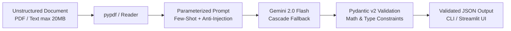

# Intelligent Document Information Extractor

> **Task 1: Structured LLM Prompt Pipeline & JSON Extractor**  
> *Datheon Python Generative AI & LangChain Internship*

An enterprise-grade Python pipeline that extracts, normalizes, and strictly validates structured JSON from unstructured PDF and text documents (Invoices & Resumes) using the Google Gemini API and Pydantic v2 schemas.

---

## 1. Architecture Overview

The pipeline ingests complex unstructured documents, isolates content using defensive delimiter boundaries, applies few-shot parameterized prompt templates, and enforces deterministic Pydantic schema validation.



### Core Specifications
* **Schema Validation:** Strict Pydantic v2 models with positive monetary validation, mathematical subtotal reconciliation, and mandatory identifier integrity.
* **Resilient LLM Client:** Native `google-genai` integration with 25-second socket timeout and automatic multi-model fallback (`gemini-2.0-flash` ➡️ `gemini-3.1-flash-lite` ➡️ `gemini-3.5-flash`).
* **Defensive Engineering:** Zero-shot and few-shot untrusted content isolation (`<UNTRUSTED_DOCUMENT_CONTENT>`) preventing prompt-injection overrides.
* **Document Ingestion:** Native PDF text extraction (`pypdf`) bounded to a 20MB file limit.

---

## 2. Project Structure

```
├── app/
│   ├── invoice_models.py    # Pydantic v2 schemas for invoices and line items
│   ├── resume_models.py     # Pydantic v2 schemas for candidate resumes
│   ├── prompts.py           # Parameterized few-shot prompt templates
│   ├── llm.py               # Gemini client wrapper with timeout & cascading fallback
│   ├── utils.py             # PDF extraction, JSON cleaning, and file validation
│   └── main.py              # CLI entry point and high-level extraction workflows
├── streamlit_app.py         # Modern full-stack interactive web dashboard
├── examples/                # Sample input PDFs and text files (Invoices & Resumes)
├── output/                  # Validated JSON extraction artifacts
├── tests/                   # 34 automated unit, schema, and security tests
├── requirements.txt         # Pinned production dependencies
└── README.md
```

---

## 3. Quick Start

### Prerequisites
* Python 3.10+ (Tested through Python 3.14)
* Google Gemini API Key ([Google AI Studio](https://aistudio.google.com/app/apikey))

### Installation
```bash
# Clone and navigate to project root
cd Task-1-LLM-JSON-Extractor

# Create and activate virtual environment
python -m venv venv
# Windows:
.\venv\Scripts\Activate.ps1
# Linux / macOS:
source venv/bin/activate

# Install dependencies
pip install -r requirements.txt
```

### Environment Configuration
Create a `.env` file in the project root:
```env
GEMINI_API_KEY=your_gemini_api_key_here
GEMINI_MODEL=gemini-2.0-flash
```

---

## 4. Execution

### Option A: Interactive Streamlit Web UI
Launch the interactive dashboard with native PDF upload, preview metrics, and instant JSON download:
```bash
streamlit run streamlit_app.py
```

### Option B: Command-Line Interface (CLI)
Execute programmatic batch extractions directly against PDF or text inputs:

```bash
# Extract and validate Invoice from PDF:
python -m app.main --type invoice --file examples/sample_invoice.pdf

# Extract and validate Resume from PDF:
python -m app.main --type resume --file examples/sample_resume.pdf
```

#### CLI Parameters
| Parameter | Status | Description | Example |
| :--- | :---: | :--- | :--- |
| `--type` | **Required** | Target schema (`invoice` or `resume`) | `--type invoice` |
| `--file` | **Required** | Path to source document (`.pdf` or `.txt`) | `--file examples/sample_invoice.pdf` |
| `--output` | Optional | Custom output destination path | `--output output/result.json` |
| `--model` | Optional | LLM model override | `--model gemini-2.0-flash` |

---

## 5. Automated Verification & Testing

The test suite validates data schemas, mathematical constraints, PDF parsing integrity, error handling, and prompt-injection defense mechanisms.

All tests utilize mocked responses and run **100% offline** without consuming API quota:

```bash
python -m pytest -v
```

```
============================== 34 passed in 0.57s ==============================
```

---

## 6. Security & Governance

1. **Prompt Isolation:** Untrusted document payloads are enclosed in boundary tags; system instructions explicitly forbid instruction execution from document content.
2. **Deterministic Schemas:** Pydantic strictly validates all extracted attributes, rejecting unauthorized extra keys or invalid types.
3. **Secret Hygiene:** Environment keys are silently resolved via `.env` or `st.secrets` without exposing tokens in logs or interfaces.
